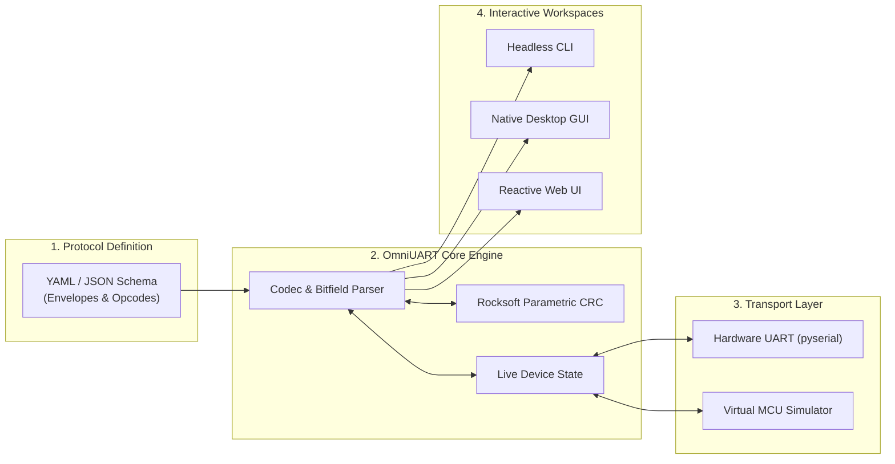

## Key figures {.stats}

| Value | Label | Change | Verdict |
|---|---|---|---|
| 100% | Zero-Python Standalone Executables | +native | good |
| 40+ | Standard Protocol Codecs & Envelopes | +18 | good |
| 32-bit | Arbitrary Rocksoft Parametric CRC | +custom | good |
| 1,050+ | Verification & Conformance Tests | 100% pass | good |

## Introduction {.abstract}

OmniUART decouples serial communication and embedded protocol engineering from custom tooling code by using declarative YAML and JSON schemas. It provides instant CLI automation alongside a native Tkinter desktop application. Additional workspaces include reactive WebSockets web monitoring, offline Virtual MCU simulation, and multi-format PCAPNG traffic export.

## 1. System architecture: end-to-end data pipeline

OmniUART processes declarative protocol definitions into dynamic codecs, connecting physical UART interfaces and virtual MCUs to multiple interactive workspaces.



[[CAPTION:Figure]] Declarative schema-driven data flow across physical UART and virtual MCU simulation transports.

```cards cols=3 style=top
Declarative Schemas | Pure YAML/JSON specs define preambles, variable-length headers, command IDs, and typed payload fields | blue
Rocksoft CRC Engine | Pure-Python parametric model calculating CRC-8/16/32, Modbus, CCITT, XOR, or arbitrary polynomials | navy
Multi-Workspace Delivery | Single source of truth serving headless automation CLI, desktop engineering GUI, and web dashboards | green
```

## 2. Protocol framing: anatomy of a message envelope

Every protocol defines an envelope layout including sync preambles, dynamic length decoding, command opcodes, typed payloads, and integrity validation.

```segments
title: Binary message envelope structure
2 | Sync Preamble (0xAA55) | 16-bit sync | navy
2 | Dynamic Length | Big/Little Endian | blue
1 | Opcode ID | Command Tag | green
8 | Typed Payload | Int / Float / Enum / Bitfield | amber
2 | Parametric CRC | Rocksoft CRC-16 | teal
2 | End Footer (0x55AA) | Frame delimiter | grey
```

> [!TIP]
> The Rocksoft parametric CRC model configures `width`, `poly`, `init`, `refin`, `refout`, `xorout`, and byte endianness to match any microcontroller hardware peripheral without recompilation.

## 3. Workspaces: CLI, Desktop, and Dynamic Web UI

OmniUART offers three dedicated operating workspaces tailored to different engineering workflows.

```flow
[Raw Serial Stream|navy] -framed-> [Dissector Engine|blue] -decoded-> [Live Inspector|green]
[Dissector Engine|blue] -export-> [Wireshark PCAPNG / JSONL|amber]
```

```cards cols=3 style=plain
Operator Workspace | Simplified one-click telemetry dials, paired Get/Set registers, segmented 16x2 matrix LCDs, and health indicators | blue
Engineer Workspace | Side-by-side hex/ASCII dumps, interactive field editor, CRC error injection, and transaction latency logs | navy
Developer Workspace | Automated regression script runner, property-based fuzzer, and hot-reloading YAML protocol schema catalog | green
```

## 4. File transfer: reliable blob and firmware update pipeline

The file transfer subsystem provides robust, chunked binary data transmission over noisy UART channels with sliding-window flow control and error recovery.

```flow
[Firmware Binary|navy] -chunk & hash-> [Sliding Window Transfer|blue] -ack/crc-> [Target Commit & Verification|green]
[Transfer Interrupted|amber] -resume token-> [Resume from Offset|blue]
```

> [!IMPORTANT]
> File transfers enforce strict two-phase commit semantics: chunks are verified on-the-fly, integrity hashes are checked before commit, and incomplete uploads roll back safely to prevent bricking target microcontrollers.

## 5. Ecosystem & Code generation: multi-language output {.wide}

From a single protocol specification, OmniUART generates production-ready code, documentation, and analysis assets across multiple language ecosystems:

```cards cols=4 style=top
C Header & Structs | Generates packed C structures, serialization functions, and CRC verification code for firmware | blue
Python Dataclasses | Generates strongly typed Python dataclasses with encode() and decode() methods | navy
AsyncAPI Spec | Exports formal AsyncAPI specifications for IoT event meshes and documentation | green
Wireshark Dissectors | Generates PCAPNG captures and dissector scripts for deep packet analysis | amber
```

## 6. Testing & HIL simulation: zero-hardware verification {cols=2}

- **Virtual MCU Simulation Engine**: Emulates device responses, baud rates, configurable delays, and jitter without physical hardware.
- **Fault Injection**: Automatically injects corrupted preambles, truncated length fields, bit flips, and CRC errors.
- **1,050+ Conformance Tests**: Pre-built suites validating Modbus RTU/ASCII, NMEA0183, MAVLink, BACnet, SLIP, COBS, and XMODEM with 100% pass rate.

## 7. Deployment: zero-friction distribution {cols=2}

- **Standalone Executables**: PyInstaller bundles for Windows (`.exe`) and Linux requiring zero Python installation.
- **Offline & Factory Safe**: 100% offline runtime with local loopback `127.0.0.1` binding, strict Host headers, and zero CDN dependencies.
- **Dual CLI Names**: Run via either `omni-uart` or `omniuart` command entries.

## In short {.summary}

Schema-driven testing brings sanity to embedded serial communication.

### Define once

One declarative schema powers documentation, CLI automation, desktop GUI, web interface, and C code.

### Test anywhere

Verify firmware logic with virtual MCU simulation before PCB prototypes arrive from fabrication.

### Deploy standalone

Package into single-binary executables that run out-of-the-box on factory test fixtures and engineering laptops.

## References {.references}

1. OmniUART System Architecture Specification, docs/architecture/system-architecture.md
2. OmniUART Protocol Schema Specification v1.0.0, docs/specs/protocol-schema-specification.md
3. Rocksoft Mathematical CRC Model, Ross Williams (1993)
4. AsyncAPI Serial Transport Protocol Binding Specification, docs/specs/asyncapi-serial-mapping.md
